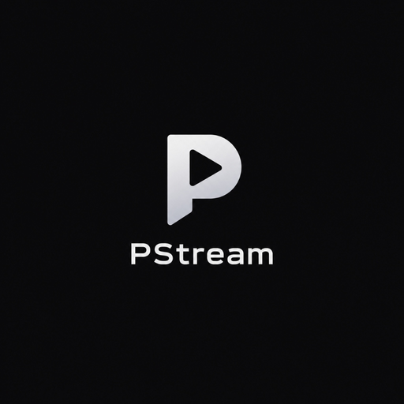
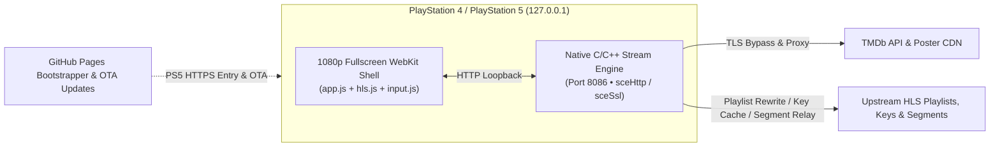

<div align="center">



# PStream

**Standalone 10-Foot Media Streaming Application for PlayStation 5 & PlayStation 4**

[](https://github.com/ducky-ux1/PStream/releases/latest)
[](https://github.com/ducky-ux1/PStream/releases/latest)
[](LICENSE)

[**Download Latest Release (v1.1.0)**](https://github.com/ducky-ux1/PStream/releases/latest) • [**Installation Guide**](INSTALLATION_GUIDE.md) • [**Report an Issue**](https://github.com/ducky-ux1/PStream/issues)

</div>

---

## Overview

**PStream** is a standalone homebrew media player built specifically for jailbroken **PlayStation 5** and **PlayStation 4** consoles. Once installed, it runs entirely on the console with **no PC, external proxy, or companion server required**.

### Key Features

- **Native PS4 & PS5 Support**
  - **PlayStation 4 (`PSTR00004`):** Installable standalone Fake PKG (`.pkg`) for GoldHEN / Mira across FW 5.05–12.02. Includes a built-in Orbis TLS & HLS segment proxy that bypasses expired root CA certificates on older firmwares.
  - **PlayStation 5 (`PSTR00001`):** Installs directly onto the PS5 **Media** tab as a borderless fullscreen application backed by an autoloading native background daemon (`pstream-service.elf`).
- **Controller-First 10-Foot UI:** Spatial D-Pad / Left-Stick navigation, L1/R1 tab & episode switching, on-screen player controls, Resume / Continue Watching, and My List.
- **Multi-Language Audio & Metadata:** Switch catalog and preferred audio stream language directly in **Settings** (`English`, `Deutsch`, `Italiano`, `Español`, `Français`, `Português`), with automatic English fallback when a localized dub is unavailable.
- **Built-In OTA Web Updater:** Update UI and extractor configurations directly from **Settings -> Check for Updates** without reinstalling.
- **Rest Mode & Long-Session Resilience (v1.1.0+):** Automatic `sceHttp` / `sceSsl` context recovery after console Rest Mode, `SIGPIPE`-hardened socket handling, dynamic TTL-cached AES-128 key proxying, and permanent GitHub Pages HTTPS bootstrapping on PS5.

---

## Quick Start

Download the appropriate package from [**GitHub Releases**](https://github.com/ducky-ux1/PStream/releases/latest):

| Console | File to Download | How to Install |
| :--- | :--- | :--- |
| **PlayStation 4** | `PStream-PS4-v1.1.0.pkg` | Copy to a USB drive (exFAT/FAT32) and install via **GoldHEN -> Debug Settings -> Package Installer**, then launch **PStream** from the Home Screen. |
| **PlayStation 5** *(USB / Payload Manager)* | `PStream-PS5-PayloadManager-v1.1.0.zip` *(or `PStream-PayloadManager.elf`)* | Run `PStream-PayloadManager.elf` once via **Payload Manager**. Launch **PStream** from the **Media** tab. |
| **PlayStation 5** *(Network / Android)* | `PStream-PS5-Upload-v1.1.0.zip` | Send `PStream-PS5Upload.elf` to your PS5 IP on port `9021` via Android **PS5 Upload**, `send_elf.ps1`, or `nc`. |
| **PlayStation 5** *(Uninstaller)* | `PStream-PS5-Uninstaller-v1.1.0.zip` *(or `PStream-Uninstall.elf`)* | Send `PStream-Uninstall.elf` once to cleanly stop the background service, remove `PSTR00001` from the Media tab, and clean `autoload.txt`. |

See [**INSTALLATION_GUIDE.md**](INSTALLATION_GUIDE.md) for step-by-step instructions and troubleshooting.

---

## Controller Mapping

| Button | In Menus | During Video Playback |
| :--- | :--- | :--- |
| **D-Pad / Left Stick** | Spatial 4-way navigation | Show controls / navigate player buttons |
| **Cross (`X`)** | Select / Play | Toggle Play / Pause (or activate focused control) |
| **Circle (`O`)** | Back / Close modal | Close player and save watch progress |
| **L1 / R1** | Switch top navigation tabs | Seek `-10s` / `+10s` |
| **L2 / R2** | Jump to top | Seek `-30s` / `+30s` |

---

## Architecture



### Repository Structure

```text
PStream/
├── docs/                       # Permanent GitHub Pages HTTPS bootstrapper for PS5 ShellCore
│   └── index.html
├── ps4/                        # Standalone PlayStation 4 fPKG source (OpenOrbis C++17)
│   ├── include/                # Orbis WebBrowserDialog ABI, VideoOut & server headers
│   ├── src/                    # main.cpp, server.cpp (TLS/HLS proxy), graphics.cpp
│   ├── sce_module/             # OpenOrbis runtime PRX modules
│   ├── sce_sys/                # PS4 icon0.png, pic1.png, right.sprx
│   └── scripts/                # build.bat & package_fpkg.bat
├── ps5/                        # Standalone PlayStation 5 Media App & Daemon (PS5 Payload SDK)
│   ├── installer/              # main.c (installer/updater), uninstall.c, Makefile, sce_sys/
│   ├── scripts/                # pstream-service.c (background daemon), Makefile, send_elf.ps1
│   └── www/                    # Shared 10-foot TV frontend (PS4 & PS5)
├── INSTALLATION_GUIDE.md
└── LICENSE
```

---

## Building from Source

### PlayStation 5 (`ps5-payload-sdk`)

Requires Linux or WSL2 with [`ps5-payload-sdk`](https://github.com/ps5-payload-dev/sdk) installed at `/opt/ps5-payload-sdk`:

```bash
# 1. Build the background stream engine daemon
cd ps5/scripts
make clean && make

# 2. Build the self-contained PS5 installer & uninstaller payloads
cd ../installer
make clean && make
```

Outputs:
- `ps5/scripts/pstream-service.elf`
- `ps5/installer/pstream-install.elf`
- `ps5/installer/pstream-uninstall.elf`

### PlayStation 4 (`OpenOrbis PS4 Toolchain`)

Requires Windows with [`OpenOrbis PS4 Toolchain`](https://github.com/OpenOrbis/OpenOrbis-PS4-Toolchain) and Python 3 (`py`):

```bat
cd ps4
call scripts\build.bat
call scripts\package_fpkg.bat
```

Output:
- `ps4/build/PStream-PS4-v1.1.0.pkg`

---

## Disclaimer

PStream does not host, store, archive, or distribute any media files. All metadata is provided by TMDb and streams are resolved on-demand from public third-party web endpoints. This project is provided strictly for educational and homebrew research purposes.

## License

Released under the [MIT License](LICENSE).
